# Databricks Connector for JMP v0.1.0

A JMP add-in that brings Unity Catalog data into JMP and writes JMP tables back. Browse catalogs and tables, write SQL, or ask Genie in plain words; import the result as a JMP data table; refresh it later; and publish a JMP table to Unity Catalog.

Works with JMP 18 or newer. Tested on JMP 19 for macOS. Windows is supported but not yet tested.

Building or changing the add-in? See [DEVELOPMENT.md](DEVELOPMENT.md).

## Quick start

1. Double-click `DatabricksConnector.jmpaddin` and click **Install**.

   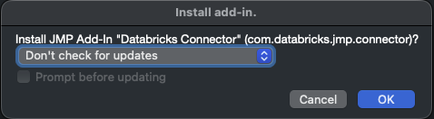

2. Open **Add-Ins > Databricks Connector…**.

   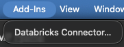

3. The first time, the connector asks to install its Python packages. Click **OK** and wait about a minute.

4. Sign in: pick a saved profile, sign in with your browser, or paste a personal access token. Click **Sign in**.

   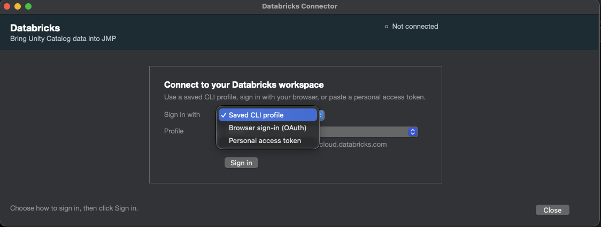

5. Pick a SQL warehouse, then a catalog, schema and table. Click **Preview**, then **Import into JMP**.

   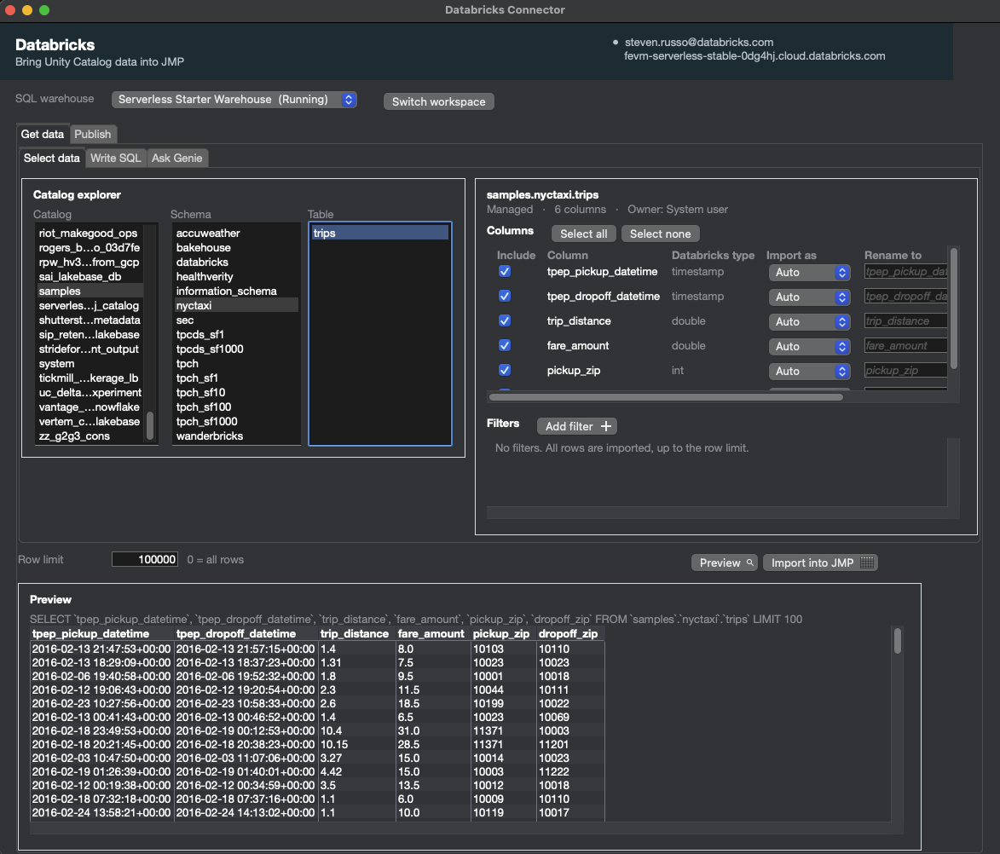

The new data table has a **Refresh from Databricks** script. Run it to update the table later.

## Before you start

- **JMP 18 or newer.**
- **Internet access to PyPI** the first time. The connector installs `databricks-sdk`, `databricks-sql-connector` and `pyarrow` into JMP's Python. If a proxy blocks this, see [Troubleshooting](#troubleshooting).
- **A Databricks workspace you can sign in to.** To use a saved profile, run `databricks auth login --host <workspace URL>` once in a terminal.
- **CAN USE on a SQL warehouse.** All queries and writes run there.
- **Unity Catalog permissions** for what you want to do:

  | To | You need |
  | --- | --- |
  | Import a table | `USE CATALOG`, `USE SCHEMA`, `SELECT` |
  | Publish to a new table | `USE CATALOG`, `USE SCHEMA`, `CREATE TABLE` on the schema |
  | Publish to an existing table | `MODIFY` and `SELECT` on the table |
  | Use Fast write | `READ VOLUME` and `WRITE VOLUME` on the volume |
  | Ask Genie | Access to at least one Genie space |

## Using it

### 1. Sign in

- **Saved CLI profile:** any workspace profile in `~/.databrickscfg`, including ones made with `databricks auth login` (OAuth) and PAT profiles. Account-level profiles are hidden.
- **Browser sign-in (OAuth):** enter the workspace URL. A browser window opens for single sign-on.
- **Personal access token:** enter the workspace URL and a token.

If your token is scoped, choose **Other APIs** when you create it and add the scopes for the features you use. The **BI Tools** preset gives only `sql`, so browsing catalogs, Genie and Fast write fail with it. A token with full workspace access (`all-apis`) needs nothing extra.

| Scope | Needed for |
| --- | --- |
| `sql` | Listing warehouses, and every query and write (preview, import, Write SQL, refresh, publish) |
| `unity-catalog` | Browsing catalogs, schemas and tables, and checking the target table when publishing |
| `genie` | Ask Genie |
| `files` | Fast write, which uploads a temporary file to a volume and deletes it afterwards |

Scopes only decide which APIs the token can call. You still need the warehouse and Unity Catalog permissions in [Before you start](#before-you-start).

You can paste a full browser URL; the connector keeps only `https://<host>`. **Switch workspace** signs out and returns to this screen.

### 2. Pick a warehouse

The warehouse you used last in this workspace is listed first, then running ones. A stopped warehouse starts when you run a query; that can take a minute.

### 3. Choose your data

**Select data:** click a catalog, then a schema, then a table. Then adjust the import:

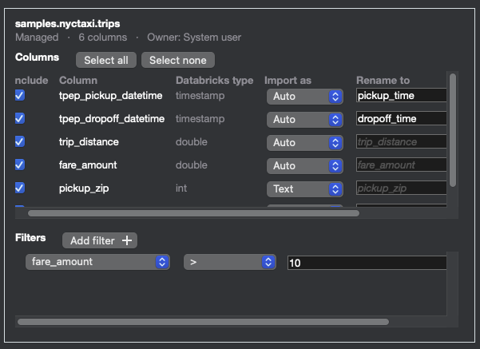

- **Columns:** untick a column to leave it out. **Import as** changes its type (Number, Text, Date or Datetime; the warehouse does the `CAST`). **Rename to** gives it a new name. The arrows reorder columns.
- **Filters:** **Add filter** adds a column / operator / value row. Rows are combined with AND. **in list** takes comma-separated values.
- **Metric views:** each column is marked *dimension* or *measure*. The import is grouped by the dimensions you include, and each measure is aggregated per group, as the metric view defines it. With no dimensions you get one total row. Filters on a dimension pick rows; filters on a measure pick groups.

  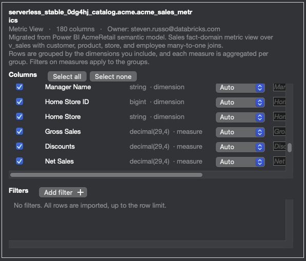

**Write SQL:** type any query. **Query name** becomes the data table's name.

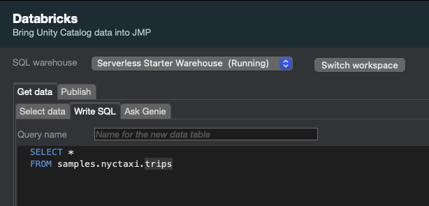

**Ask Genie:** pick a Genie space and ask a question in plain words, for example *"Average cycle time by line for last month"*. Genie's answer and its SQL appear below. Ask follow-ups to refine it, or click one of Genie's **Follow-ups**. **New conversation** starts over. If the SQL is almost right, **Edit in Write SQL** copies it there so you can change it. Answers take about 5–30 seconds.

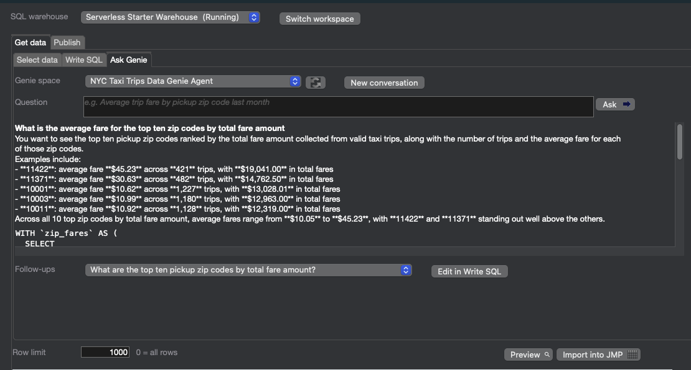

Genie's SQL runs on the warehouse you picked, not Genie's own.

### 4. Preview and import

Set the **Row limit** (0 = all rows). **Preview** shows the first 100 rows and the SQL that will run. **Import into JMP** opens a new data table.

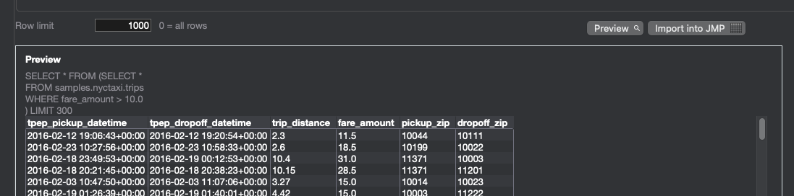

### Refreshing a table

Each imported table gets a **Refresh from Databricks** script (red triangle menu, or the table panel). It re-runs the saved SQL on the same warehouse. The SQL is saved in the table variable **Databricks Source**.

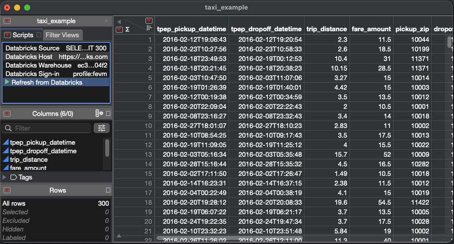

- The query runs first. Rows are replaced only if it succeeds, so a failed refresh never changes your data.
- The first refresh of a query you didn't import in this JMP session asks first. It shows the workspace, warehouse and SQL, and runs only when you click **Run**. A refresh prompt will show up and ask to reset the connection.

- Columns are updated by name, so formula columns, saved scripts and graphs keep working. New result columns are added. If a column changed type in Databricks, the refresh stops before changing anything and asks you to import again.
- Signing in: if the connector is signed in to that workspace, the refresh uses that session. Otherwise profile and OAuth tables reconnect by themselves (OAuth may open your browser). PAT tables ask you to sign in, because tokens are never saved with a table.
- When a refresh fails, a dialog shows the error and offers **Sign in…**. Sign in, then run the refresh again.

### Publishing to Unity Catalog

The **Publish** tab writes an open JMP data table to a Unity Catalog table.

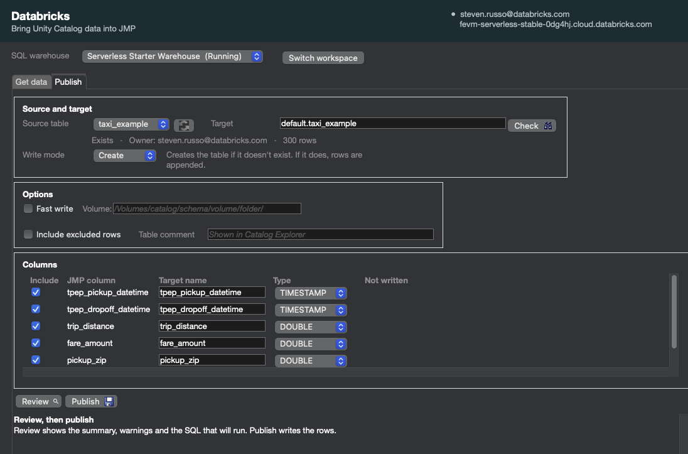

1. Pick the source table.
2. Type the target as `catalog.schema.table`. A bare `table` or `schema.table` uses the warehouse's default catalog and schema; **Check** fills in the full name and shows whether the table exists.
3. Check the column grid: target names, types, and which columns to include.
4. Pick a write mode:
   - **Create:** creates the table if it doesn't exist. If it exists, rows are appended and the review warns you.
   - **Append:** adds rows. The columns must match the existing table.
   - **Overwrite:** replaces all rows. You confirm first; the dialog names the table and its row count.
   - **Upsert:** tick the key columns (Upsert key). Matching rows are updated, others are inserted. Keys must be unique in the JMP table.
5. Click **Review** to see the summary, warnings and SQL. Nothing is written yet.
6. Click **Publish**.

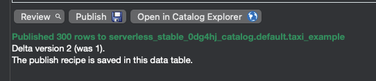

**Fast write** (off by default) uploads one Parquet file to a volume you name, for example `/Volumes/quality/spc/uploads/`, then loads it in one statement. Use it for large tables; the tab suggests it above 10,000 rows. Without it, rows go in batches of inserts.

After a publish, the JMP table keeps the settings in a table variable **Databricks Publish Recipe** (no token) and gets a **Publish to Unity Catalog** script that repeats the publish. The script always asks first, naming the mode, row count, target and workspace.

**If a publish fails partway (default path):** each batch commits on its own, so the batches already written stay. The error says how many rows were written and gives the exact `RESTORE TABLE … TO VERSION AS OF …` command to undo them. Fast write loads in one statement, so it never leaves partial rows.

## Sharing a .jmp file

You can share a data table made by the connector like any .jmp file. Things to know:

- **The rows in the file are what you could see.** Unity Catalog doesn't filter them for the person you send them to. Share the file only with people allowed to see that data.
- **Their refresh and publish run as them,** with their own permissions. A refresh may return fewer rows, or fail, for someone with less access.
- They need the add-in installed and **CAN USE** on the same warehouse.
- **Saved profile sign-in:** the profile name is saved, not the profile. It works only if their profile with that name points at the same workspace. If not, the refresh stops and asks them to sign in.
- They are asked before an unfamiliar query runs, and before any publish.

## Troubleshooting

| What you see | Likely cause | What to do |
| --- | --- | --- |
| No **Databricks Connector…** in the Add-Ins menu | The menu didn't load | Run `Include( "$ADDIN_HOME(com.databricks.jmp.connector)/databricks_connector.jsl" );` in a script window, and report it. |
| "Installing the Databricks packages failed" | No access to PyPI (proxy or firewall) | Ask IT for PyPI access, or install from a JMP script window: `Python Submit( "import jmputils; jmputils.jpip('install', 'databricks-sdk databricks-sql-connector[pyarrow]')" );` |
| Sign-in fails with a certificate or SSL error | A proxy replaces HTTPS certificates | Ask IT for the proxy's CA certificate file. Set both `SSL_CERT_FILE` and `REQUESTS_CA_BUNDLE` to its path, then restart JMP. |
| "Not signed in to <host>" on refresh | PAT table, or no saved sign-in | Click **Sign in…**, sign in to that workspace, then refresh again. |
| "Profile 'X' is for …, not …" | Your profile with that name points at another workspace | Click **Sign in…** and sign in to the workspace shown. |
| An error names a missing scope | Your personal access token is scoped and lacks it | Add the scope to the token (see [Sign in](#1-sign-in)). Scope changes can take up to ten minutes to apply. |
| A query fails with a permission error | Missing warehouse or Unity Catalog permission | See [Before you start](#before-you-start), and ask the data owner. |
| An import hangs at the download step | Your network blocks direct cloud-storage downloads (firewall or private link) | Ask your Databricks admin. Smaller results (row limit, fewer columns) may still work. |
| "Column 'x' changed type in Databricks" | The source table changed | Import the table again. |
| "Upsert keys are not unique" | Duplicate keys in the JMP table | Remove the duplicates or pick other key columns. |
| JMP stops responding during a query | Normal: JMP waits for the query | Wait. Use the row limit or filters for large tables. |

**The log** has the details of every call: `~/Library/Logs/DatabricksConnector.log` on macOS, `%LOCALAPPDATA%\DatabricksConnector.log` on Windows. Errors also show in red in the connector's status bar, or in a dialog when a table's Refresh or Publish script fails.

## Security

- **Tokens:** a personal access token is held only in memory by the Databricks SDK. The token box is cleared after sign-in, and the token is removed from JMP's Python variables after each call. It is never written to the log or saved with a table.
- **What tables save:** the host, warehouse ID, SQL, and how you signed in (profile name, `oauth` or `pat`). Never a secret.
- **Profiles stay with their workspace:** a saved profile is used only for the workspace it was made for. A table pointing at another workspace can't send that profile's token there.
- **Shared files:** a refresh shows unfamiliar SQL before it runs, and a saved publish always asks first.
- **OAuth:** tokens are cached by the Databricks SDK in `~/.config/databricks-sdk-py/oauth`, readable only by you. CLI profiles use the Databricks CLI's own token cache.
- **Switch workspace** signs out: the window's client and its warehouse sessions are closed.
- **Encryption:** all connections use HTTPS with certificate checks.
- **The log** is readable only by you. It holds your user name, groups and SQL text, but no tokens.

## Type mapping

Importing:

| Databricks | JMP |
| --- | --- |
| tinyint/smallint/int/bigint/float/double/decimal | Numeric, Continuous |
| date | Numeric, `yyyy-mm-dd` format |
| timestamp / timestamp_ntz | Numeric, `yyyy-mm-ddThh:mm:ss` format (converted to UTC) |
| everything else (string, boolean, arrays, structs…) | Character |

Large `bigint` and `decimal` values are stored as doubles. Values with more than about 15 significant digits lose precision.

Publishing: Character columns become `STRING`. Numeric columns become `DOUBLE`, `BIGINT` (whole numbers with a Fixed Dec 0 format), `DATE` or `TIMESTAMP` (from date formats); you can change the type in the column grid.

## Known limits

- JMP doesn't respond while a query runs, and there's no progress display.
- Download speed depends on your network. On a 7 MB/s link, 5M rows of a wide table (about 1.2 GB) take about 3 minutes.
- Ask Genie: Genie runs its own query too, so a Preview runs the SQL a second time on your warehouse. Genie's `:parameters` are filled in as quoted values. Genie's charts, feedback and history aren't shown. Asking across all your data without a space (Genie One) isn't built.
- Not built yet: saved workspace queries, query parameters, saved imports, pivot, and value pickers for filters.

## Install, upgrade, uninstall

- **Upgrade:** open the new `DatabricksConnector.jmpaddin` and click **Install**. It replaces the old version.
- **Uninstall:** **View > Add-Ins**, select *Databricks Connector*, click **Unregister**.

## What's in v0.1.0

- Sign in with a CLI profile, browser OAuth, or a personal access token.
- Import by browsing Unity Catalog (with column types, renames and filters), by writing SQL, or by asking Genie. Includes metric views.
- Refresh imported tables in place.
- Publish JMP tables to Unity Catalog: create, append, overwrite or upsert, with an optional fast write through a volume.
